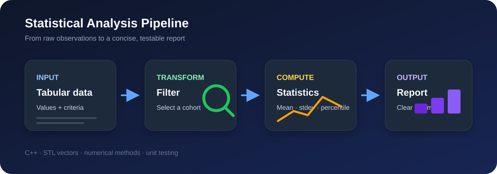
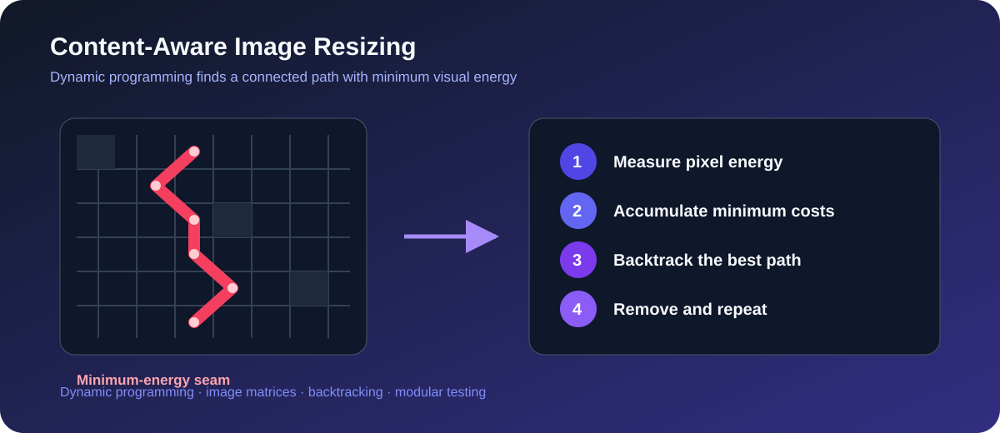
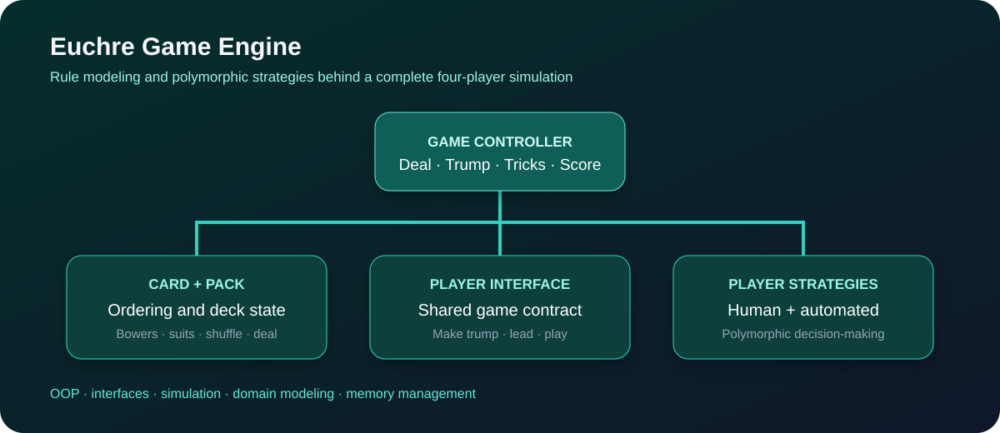

# C++ Systems & Algorithms — Project Showcase

Three projects that strengthened my foundations in C++ software design, testing, data structures, and algorithmic problem-solving.

> **Academic integrity:** This repository is a portfolio overview, not a solution archive. Source code and course-provided tests are intentionally private in accordance with University of Michigan EECS 280 policy. I am happy to discuss my design decisions, debugging process, and takeaways in an interview.

## At a glance

| Project | What I built | Core concepts |
|---|---|---|
| [Statistical Analysis Toolkit](#1-statistical-analysis-toolkit) | A command-line data analysis program and reusable statistics functions | STL vectors, numerical methods, CSV-style data processing, unit tests |
| [Content-Aware Image Resizer](#2-content-aware-image-resizer) | A seam-carving image resizer that preserves visually important content | Dynamic programming, 2D matrices, image representation, algorithm decomposition |
| [Euchre Game Engine](#3-euchre-game-engine) | A complete four-player card game with human and automated strategies | Polymorphism, object-oriented design, simulation, rule modeling, memory management |

## 1. Statistical Analysis Toolkit

I implemented a small statistics library and used it in a command-line analysis workflow. The library computes count, sum, mean, median, minimum, maximum, sample standard deviation, interpolated percentiles, and filtered subsets.

### Engineering highlights

- Used value-oriented functions with `std::vector<double>` inputs and predictable outputs.
- Implemented percentile interpolation and corrected sample standard deviation.
- Separated reusable numerical operations from application-level input and reporting.
- Wrote focused unit tests for typical inputs, boundary cases, and even/odd sample sizes.

### What I learned

Small mathematical functions still need careful attention to indexing, floating-point behavior, and preconditions. Testing each operation independently made later application debugging much faster.

## 2. Content-Aware Image Resizer

I implemented seam carving: an algorithm that reduces an image's dimensions by repeatedly finding and removing a connected path of low-energy pixels. Unlike ordinary scaling, it attempts to preserve high-detail regions.

### Engineering highlights

- Represented images and intermediate computations with reusable matrix abstractions.
- Calculated pixel energy from color gradients to estimate visual importance.
- Used dynamic programming to build a cumulative-cost matrix.
- Backtracked through the matrix to recover a minimum-cost seam.
- Extended vertical seam removal to height reduction through image rotation.
- Tested matrix operations, image operations, seam selection, and full resizing separately.

### Algorithmic pipeline

1. Compute an energy score for every pixel.
2. Accumulate the cheapest reachable cost row by row.
3. Backtrack from the minimum value in the final row.
4. Remove one pixel from each row along that seam.
5. Repeat until the target dimensions are reached.

### What I learned

This project made dynamic programming concrete: the table was not just an abstract recurrence, but the bridge between local pixel differences and a globally optimal path.

## 3. Euchre Game Engine

I modeled the rules and full game loop for four-player Euchre, including dealing, trump selection, trick resolution, scoring, and both human-controlled and automated players.

### Engineering highlights

- Encapsulated card ordering, suit behavior, and trump-specific rules in a `Card` abstraction.
- Modeled deck state, dealing, reset, and deterministic shuffling in a `Pack` abstraction.
- Used a common player interface with human and automated strategy implementations.
- Coordinated multiple rounds and score transitions through a dedicated game controller.
- Covered rule-heavy edge cases such as bowers, following suit, dealer behavior, euchres, and marches.
- Managed polymorphic player lifetimes and kept game mechanics separate from player decisions.

### What I learned

Rule-heavy software benefits from explicit domain models. Once card ordering and player responsibilities were isolated, the main game loop became easier to read, test, and reason about.

## Skills demonstrated

- **Language:** C++
- **Programming:** object-oriented design, interfaces, dynamic memory, STL containers, file I/O
- **Algorithms:** dynamic programming, searching, sorting, filtering, simulation
- **Quality:** unit testing, test decomposition, assertions, deterministic test data, debugging
- **Design:** modular APIs, separation of concerns, domain modeling

## Interview discussion prompts

- How the seam-carving recurrence guarantees a globally minimum-cost path.
- Why trump changes the effective suit and ordering of certain Euchre cards.
- How I structured tests around edge cases rather than only happy paths.
- What I would change for production: stronger ownership types, const-reference parameters, richer error handling, and performance profiling.

## About the work

These projects were completed as part of **EECS 280: Programming and Introductory Data Structures** at the University of Michigan. This public overview contains only original explanatory material and diagrams; implementation code remains private.

